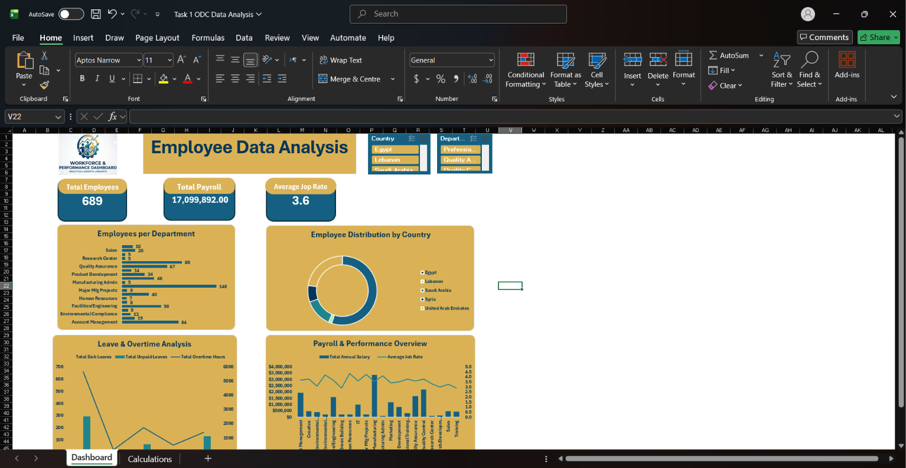

# Task 1 — Employee Workforce Dashboard (Excel)

## Objective
Build an Excel dashboard from an Employee dataset to help management understand the workforce and support decisions. No predefined design was given, so the metrics, charts and slicers were chosen by me as the analyst.

## Dataset
Employee records with: department, country, center, years of service, monthly salary, annual salary, job rate, sick leaves, unpaid leaves and overtime hours.

## Requirements covered
- 7 calculated columns
- 7 DAX measures
- 3+ KPI cards
- 5 Pivot Tables (kept on a `Calculations` sheet)
- 4 Pivot Charts
- Slicers for interactivity
- Logo and dashboard title
- Everything arranged on a single `Dashboard` sheet

## Examples of analysis
- Total annual salary and average job rate by department
- Workforce distribution across departments, countries and centers
- Leave and overtime patterns

## Files
- `Task_1_ODC_Data_Analysis.xlsx` — workbook with the `Dashboard` and `Calculations` sheets
- `Data_Analysis_-_Task_1.pdf` — task brief

## Tools
Microsoft Excel (Data Model, DAX, Pivot Tables, Pivot Charts, Slicers)

